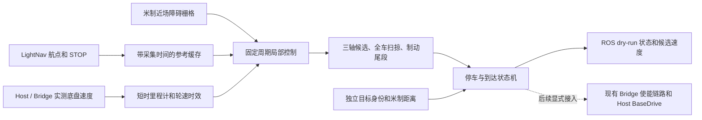

# AlohaMini 小脑 V1

运行基线为 `jjy/lightnav-vln` 的 `737d43b`。小脑位于 `src/alohamini/cerebellum`，底盘参数通过当前仓库的 `get_robot_model` 加载。ROS 输出为 dry-run 诊断消息。



## M0 代码与时间戳审计

- `runtime/base_lift_control.py` 对三轮 `velocity_raw` 核对总线批次、Host 会话和采样顺序。缺失任一轮时不会生成有效机体速度。原生 `BaseDrive` 统一轮序、单位和每轮最高 3000 ticks/s 的比例限幅。
- `runtime/host.py` 用反馈总线批次的采集区间中点和 Host 的单调时钟、Unix 时间参考构造 `state_sample_unix_ns`。Host 对外通道报告 `theta.vel` 的单位是度每秒。Bridge 将观测转为 SI 的 `/alohamini/base_velocity`，消息为 `TwistStamped`。Bridge 的 `receipt` 给消息打本地接收时间，`host_wall` 保留 Host 的样本时间。两者对传输延迟的解释不同。
- 当前工作区正式底盘文件和证据 ZIP 内四份 `control-reference` 快照逐字节一致。5090 的部署目录另有未提交的双摄脚本和后续排队处理，历史试跑以当次日志为准。5090 的 LightNav-0 源码为 `3015508`。其参考路径使用以拍摄时底盘为原点的三元航点。单摄 MPC 按 `v, ω` 跟踪，横向速度为零。
- 5090 旧双摄流程将相机与轮速设为 `host_wall`，以工作站 ROS 当前时间判断年龄。同一 ROS 执行循环在推理、胸部分割、轮速回调和求解之间切换。位姿匹配允许 120 ms。后续发送再查轮速 250 ms、双摄配对及图像总时效，命令时效基于较早的相机采集时间加 450 ms。早期双摄路径使用粗略 RGB 地平面估计，整片可见门槛与窄路拒绝会产生 HOLD。
- 轮速 CSV 记录回调收到的样本值和消息头时间，两个文件缺少共同的回调接收时钟及实际消费序号。46 次 `wheel_feedback_stale` 当时都有带较近头时间的 CSV 样本。这个证据能排除 CSV 中轮速长时间断档，仍需实际采集 Host 到达、缓存更新、消费时间和跨机偏差来定位旧流程。

## 运行离线回放与测试

在仓库根目录运行。证据路径可以指向 ZIP 解压后的根目录，也可以使用已有双摄数据目录。软件运行使用标准库和仓库自带模型资产。

```powershell
$env:PYTHONPATH = 'src'
$env:CEREBELLUM_EVIDENCE = 'D:/CodexWorkspaces/Codex/LightNav-evidence-staging'
python -m alohamini.cerebellum.replay --evidence $env:CEREBELLUM_EVIDENCE --run reg6LOUn --out ../outputs/cerebellum/reg6LOUn
python -m alohamini.cerebellum.replay --evidence $env:CEREBELLUM_EVIDENCE --run At98ZJIA --out ../outputs/cerebellum/At98ZJIA
python -m alohamini.cerebellum.replay --evidence $env:CEREBELLUM_EVIDENCE --run At98ZJIA --out ../outputs/cerebellum/synthetic --scene single-block --inject reference_stale@3 --inject unknown@5 --inject stop@6 --inject wheel_stale@8
python -m unittest discover -s tests -p 'test_cerebellum_*.py' -v
```

`original-events.json` 保留原始事件字段。`timeline.csv` 对齐各时戳和原系统理由。`controller.jsonl` 有当前参考有效期、实际消费反馈 stamp、选中轨迹、各可行候选打分和逐候选拒绝原因。`report.md` 和两份 summary 区分实机统计及离线输出。`--scene recorded` 仅依据已有证据运行。可选合成地图在已录轮速上计算反事实控制量，位姿仍沿原试跑移动。故障时间相对第一条决策，注入在指定时刻后持续生效。

## 状态、碰撞检查和 ROS 接口

- 所有核心输入使用同一单调时间轴。机体帧 `base_link` 的 +x 向前，+y 向左，+yaw 逆时针。采集时刻的航点通过历史插值变换到局部 `odom`，当前轮速短时积分会漂移。反馈断档重建局部坐标原点，之后需要同一原点下的新地图和参考。
- 采样器沿 `vx、vy、ω` 取值，校验候选与测量值及上一指令的加速度窗口、合成平移速度、角速度和仓库原生轮速。按凸多边形检查平移、横移和转弯扫掠，并检查到静止的制动尾段。网格分为 FREE、OCCUPIED、UNKNOWN，空格沿用 UNKNOWN。占据地图需要来源、单位、坐标系和观测时间。输出间距为合成地图下保守下界，受搜索上限截断。
- 控制周期默认 20 Hz。记录抖动、错过的周期和执行耗时。运动命令有效期取命令 TTL、参考 TTL、反馈时效和地图时效的最早期限。超时后只允许经过已知扫掠验证的制动命令，或归零并保持。最终实际制动由 Host 负责，真实制动曲线待测。
- `STOP` 锁存停车请求。控制器依次使用反馈确认停车及静止，随后才读独立身份和米制距离。距离或身份缺失时输出 `REOBSERVE / UNKNOWN`。当前适配器一进程对应一次任务，显式开始新任务需新建控制器实例。

ROS 2 环境激活后可执行 `python -m alohamini.cerebellum.ros_adapter`。单线程 ROS 执行器串行处理状态和计时器，独立于 LightNav 推理进程。周期计时器用 steady clock。跨机时间使用 Unix stamp，通过本地 Unix/steady 对映换算。非 Unix、未来、明显延迟的 stamp 会拒绝。时钟跳变锁存故障。运行前核对 Host 与工作站时钟同步，尤其是小于接受窗口的恒定偏差。

| 话题 | 类型与语义 | QoS |
|---|---|---|
| `/alohamini/base_velocity` | `geometry_msgs/TwistStamped`，`base_link`，m/s、rad/s | BEST_EFFORT，深度 10 |
| `~/reference` | `nav_msgs/Path`，header 为采集时间，同一 `base_link` 或 `odom`，按帧输入 | RELIABLE，深度 1 |
| `~/local_grid` | `nav_msgs/OccupancyGrid`，`odom`，轴对齐，0 和 100 分别为 FREE、OCCUPIED，其余为 UNKNOWN。参数 `grid_source` 标明来源 | RELIABLE，深度 1 |
| `~/stop` | `std_msgs/Bool`，true 帧连续达到确认数后锁存停车意图 | RELIABLE，深度 10 |
| `~/arrival` | `std_msgs/String`，JSON 字段 `stamp_ns`、`target_id`、`target_confirmed`、`distance_m`、`source`。身份必须与 `target_id` 参数匹配 | RELIABLE，深度 1 |
| `~/decision` | `std_msgs/String`，JSON dry-run 状态、消费样本、规划速度、时效和轨迹 | RELIABLE，深度 1 |

当前适配器只注册诊断发布器。显式设置 `dry_run=false` 会在初始化时拒绝启动。合成消息集成测试需在 Linux ROS 环境中设置 `ROS_LOCALHOST_ONLY=1`、独立的 `ROS_DOMAIN_ID` 和 `CEREBELLUM_ROS_SMOKE=1`。默认 Windows unittest 会跳过这项并运行其余离线测试。

### 使用真实 LightNav 推理回放既有相机

在 5090 另选一个本机 ROS 域。启动本机 LightNav WebSocket 服务与小脑 dry-run 节点后，从仓库根目录运行：

```bash
export PYTHONPATH="$PWD/src"
export ROS_LOCALHOST_ONLY=1 ROS_DOMAIN_ID=219
python examples/navigation/lightnav_cerebellum_dry_run.py \
  --server ws://127.0.0.1:<port> \
  --trial ~/workspace/jjy/datasets/lightnav-mpc-trial-hYKKUhuc \
  --out ~/workspace/jjy/validation/cerebellum-v1/recorded-recheck \
  --synthetic-after-s 1.5
```

脚本使用原录像中能够找回拍摄时间的帧，重新跑 LightNav 推理，并重基准回放原实测轮速。ROS 参考路径，使用原拍摄事件重基准后的时间，整段三元航点作为 `Path` 发布。前 1.5 秒没有米制地图，之后提供合成空地图以验证跟踪。轮速回放保持原轨迹，规划输出只用于验证消息链与时序。脚本在收尾检查小脑 ROS 发布图，输出 LightNav 原始推理结果、小脑逐周期诊断和汇总。

## M1 局部规划与停车复核

每次规划从当前车身的实际凸多边形计算已覆盖的 UNKNOWN 格，余下扫掠与制动共享这组格子。外扩安全边距中的 UNKNOWN 保持阻断，所有 OCCUPIED 格均参与碰撞检查。地图构建时按行索引连续区间，碰撞检查搜索车身与边距覆盖的窗口，距离查询按 clearance_cap 截取局部窗口。

默认沿参考弧长向前取 0.8 m 的引导点。直达通道受阻时，规划器以 0.08 m 为间隔，在两侧各搜索至 0.88 m 的横移绕行路线，依次验证横移、平行前进及返回引导点三段的车身扫掠。每周期使用最新地图重新验证保留的绕行路线。局部搜索范围之外的绕路需要上层更新参考。

速度候选包含指向引导点的速度和全向底盘四个平移方向。首条指令同时受反馈、前次指令、加速度和三轮转速约束。前瞻段受加速度约束并检查旋转与平移扫掠，再验证制动尾段。原地等待与移动按几何进展比较，候选之间再比较间距、平滑性及路径偏差。靠近参考终点或绕行拐点时同步降低接近速度。

ROS 参数 `stop_confirm_count` 控制连续 STOP 帧数，默认 1；新鲜且被控制器接受的参考消息或 false 会清零计数。停车并确认静止后，独立观测若确认目标仍远，且收到停车后采集、可变换的新鲜参考，控制器可从 REOBSERVE 恢复规划。目标身份或距离缺失时保持 REOBSERVE。ROS 控制周期使用原生 steady timer 截止时间统计漏周期及抖动。

在隔离域运行合成近场障碍的计时验收：

```bash
export ROS_LOCALHOST_ONLY=1 ROS_DOMAIN_ID=173 PYTHONPATH="$PWD/src"
python examples/navigation/benchmark_cerebellum_ros.py --cycles 240 --out /tmp/cerebellum-m1-timing
```

### M1.1 回归点与终点逼近

0.8 m 是首个回归点的前瞻距离。直达或三段绕行失败后，控制器沿参考弧长继续搜索到终点，先检查回归点能否容纳整车，再检查各段扫掠。保留的绕行路线每周期都依据当前地图和参考复查。若终点格已占据，控制器沿参考回溯到与终点相连的占据区域前沿，以整车轮廓及安全边距计算停车位置，并在完整地图上验证。进入该位置 1 mm 内输出 `terminal_standoff`；到达确认仍依赖独立目标证据。

接近速度同时预留恒速前瞻距离和制动尾段。存在朝向误差时加入原地旋转候选。首步速度投影到实测轮速与前条指令的两个加速度窗口交集，随后检查机体和三轮速度限制。复现中距离障碍的 ROS 场景可执行 `python examples/navigation/benchmark_cerebellum_ros.py --blocked-lookahead --cycles 360 --out /tmp/cerebellum-m11-timing`。

## 低速实机接入与 MPPI 兼容

1. 在导航姿态实测 `base_link` 下车身多边形及机械臂、附件突出范围。在现场地面测直行、横移和旋转的制动能力、反馈延迟、加速度以及三轮饱和后轨迹。当前 JSON 里的制动、轮廓和多数阈值属于离线假设。
2. 给出可信近场米制数据源，实测贴地积木和横移区覆盖，核对轮速与相机时钟。接通真实传感器后的 dry-run 日志，验收最大计算耗时、周期抖动、最小间距及停止流程。另行接入可靠的目标身份和距离，才能在实机确认 `ARRIVED`。
3. 低速输出接入现有 Bridge 的显式使能、超时停止和 Host 控制权链路。逐项验证断联、反馈丢失和规划过期时的底盘实际制动。

后续接 Nav2 MPPI Omni 可复用相同的语义。提供时间一致的 `nav_msgs/Odometry` 和 `odom → base_link` TF，将参考转换成 `odom` 下的 `nav_msgs/Path`，局部 costmap 使用实测 footprint 和可信的深度、点云或测距。MPPI 替换 `Planner.choose` 所在的候选搜索环节，命令过期、STOP 核验及最终 Bridge 接管仍由各自的控制层处理。部署时按目标 ROS 发行版验证消息类型、插件配置和轮速限制。

## M2a RGB depth dry-run

`RollingLocalGrid.update(depth, K, T_base_from_optical, stamp=..., pose_odom=...)` accepts a
rectified optical-axis depth image in metres, rectified intrinsics, and the camera-to-base
transform at zero lift. Supply capture-time wheel pose and, for the chest camera, the capture-time
lift offset in metres. The optional floor and self masks must be registered to the depth image.
The floor plane is fitted on unmasked candidate pixels. Insufficient consensus, implausible scale
or excessive tilt rejects the frame before the map is modified.

`export(now)` returns a 4 m square odom grid at 5 cm resolution. Ground points from -5 to
+4.5 cm mark FREE; points above +4.5 through +125 cm mark OCCUPIED. Unobserved cells are UNKNOWN.
Occupancy has priority during the 1.75 s memory window. Reanchor the map when wheel odometry
changes epoch. The exported stamp remains the last accepted observation time.

Nominal geometry yields `uncalibrated_rgb_preview`, which the V1 controller rejects. To declare
measured geometry the caller must supply matching accepted intrinsic and base-frame extrinsic
result documents via `CalibrationSource`. The camera ID, intrinsic resolution, K, and transform
must agree. A mixed-provenance epoch stays preview until reanchored.
